<picture>
  <source media="(prefers-color-scheme: dark)" srcset="assets/contributions-dark.svg">
  <source media="(prefers-color-scheme: light)" srcset="assets/contributions.svg">
  
</picture>

# 📊 GitHub Stats:

 

### ✍️ Random Dev Quote

---
